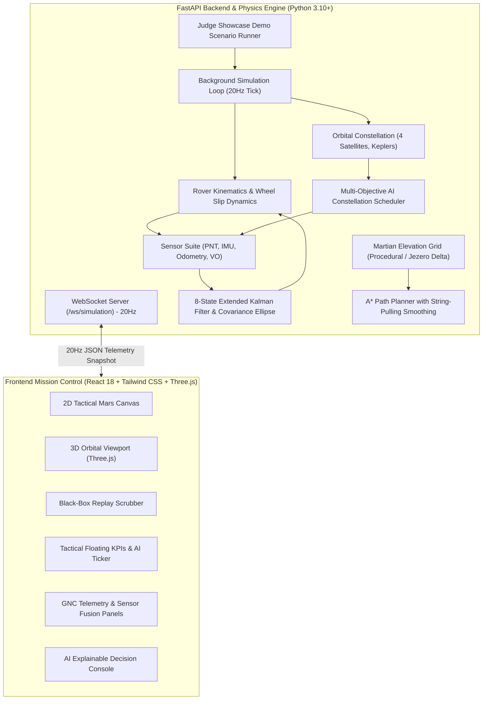

# NAVIS — Networked Adaptive Visual & Intelligent Space Navigation

> **Adaptive Intelligence for Navigation Beyond Earth**  
> *A full-stack, aerospace-grade mission control and simulation platform demonstrating autonomous planetary rover navigation in GPS-denied environments through multi-sensor fusion, dynamic satellite constellation scheduling, and real-time hazard avoidance.*

[](#)
[](#)
[](#)
[](#)
[](#)

---

## 🛰️ 1. Problem Statement & Mission Overview

Planetary rovers on Mars (such as NASA's *Perseverance* and *Curiosity*) navigate in **complete absence of Earth-like GPS infrastructure**. Radio communication signals between Mars and Earth take 4 to 24 minutes one-way, making real-time joystick piloting from Ground Control impossible.

Current mission architectures face three critical bottlenecks:
1. **Unbounded Dead-Reckoning Drift**: Relying solely on onboard IMUs and wheel odometry leads to quadratic error accumulation ($10\text{--}20\text{m}$ drift), steering rovers dangerously close to steep crater rims and sharp boulder fields.
2. **Intermittent Orbital Constellations**: Mars orbiters (e.g., MRO, Mars Odyssey, TGO) have periodic orbital passes with limited communication footprints and conflicting mission priorities (positioning vs. high-resolution imaging vs. ground-relay communications).
3. **Severe Atmospheric & Terrain Hazards**: Unmapped rock fields, sudden dust storms occluding camera visual odometry, and wheel slip in loose regolith cause catastrophic mission delays or wheel entrapment.

### The NAVIS Solution
**NAVIS** is an autonomous planetary GN&C (Guidance, Navigation & Control) flight simulation and mission-control platform. It pairs high-rate onboard multi-sensor fusion with dynamic satellite resource arbitration to guarantee continuous, certified localization accuracy even during total orbital blackouts and extreme dust storms.

---

## 🚀 2. Key Features

### 🧠 8-State Extended Kalman Filter (EKF) Sensor Fusion
- Seamlessly fuses stochastic measurements from 4 sensor streams:
  - **Satellite PNT** ($\sigma \approx 0.45\text{m}$ absolute positioning when locked)
  - **IMU 6-DOF Accelerometer & Gyro** (with real-time online bias estimation: $b_{ax}, b_{ay}, b_\omega$)
  - **Wheel Odometry** (with dynamic terrain slip compensation: $1\text{--}18\%$)
  - **Visual Odometry (VO)** (relative translation tracking with feature confidence estimation)
- **Autonomous Outage Fallback**: Transitions instantaneously to dead-reckoning fusion during satellite horizon loss or blackouts, realistically propagating 2-sigma ($95.4\%$) covariance uncertainty ellipses.

### 🏁 Live "Shadow Race" (Mode A vs. Mode C)
- Judges can watch a dual-rover race in real time on identical Martian topography:
  - **Primary Rover (Mode C NAVIS AI)**: Dynamically tasks satellites, plans optimal routes, and avoids hazards.
  - **Shadow Rover (Mode A Dead Reckoning)**: Runs strictly blind on uncorrected IMU/odometry.
- Direct live comparison displays drift accumulation, collision counters, and percentage accuracy advantage.

### 🔴 Jezero Crater River Delta & Dynamic Dust Storms
- **Jezero Crater Terrain Preset**: Deterministic $600\text{m} \times 600\text{m}$ elevation map modeled on NASA's Jezero Crater: raised western rim ridge ($35\text{m}$ elevation), branching delta escarpments with steep cliff edges, and ancient lakebed floor with Belva remnant craters.
- **Dynamic Moving Dust Storm**: A drifting atmospheric particle storm with smooth edge-bouncing physics that engulfs the rover's path, degrading Visual Odometry tracking by $5\times$ and forcing the AI Scheduler to elevate PNT priorities.

### 🤖 Multi-Rover Swarm & Orbital Satellite Contention
- Deploys **3 distinct rovers** simultaneously:
  - **ROVER-1 (Alpha / Scout)**: High priority ($1.25$), agile, charting northern corridors.
  - **ROVER-2 (Beta / Sampler)**: Medium priority ($1.0$), science payload, central plains.
  - **ROVER-3 (Gamma / Hauler)**: Heavy payload ($0.85$), slower transit, southern sector.
- **Multi-Objective AI Scheduler**: Arbitrates 4 orbital satellites among 3 rovers using a multi-criteria utility function based on line-of-sight elevation, position covariance need, and task urgency.

### 🌌 Interactive 3D Mars & Orbital Viewport
- Seamless one-click toggle between **2D Tactical Radar** and **3D Orbital View** built with React Three Fiber (`@react-three/fiber` & `@react-three/drei`).
- Features a mathematically displaced 3D Martian terrain mesh shaded in matte regolith tones, dynamic 3D low-poly rover chassis, satellite orbital nodes with real-time RF communication cones, and orbital chase / nadir camera views.

### 📼 Mission Black-Box Telemetry Replay & PDF Debrief
- **1,200-Frame In-Memory Ring Buffer**: Records live 20Hz telemetry snapshots.
- **Interactive Scrubber Bar**: Scrub backwards in time to analyze critical moments with tagged event flags for Hazards (Amber), Outages (Red), Dust Storms (Yellow), and Swarm Deployments (Violet).
- **One-Click Flight Certification Debrief**: Generates NASA/JPL-styled printable PDF mission debrief summaries and structured `.CSV` flight recorder exports.

### ⌨️ Presenter Keyboard Shortcuts & Judge Autopilot
- Global keyboard hotkeys designed for live pitch presentations (<kbd>Space</kbd>, <kbd>V</kbd>, <kbd>S</kbd>, <kbd>M</kbd>, <kbd>D</kbd>, <kbd>O</kbd>, <kbd>R</kbd>, <kbd>?</kbd>).
- Automated 8-stage Judge Showcase Demo scripted to walk through all core capabilities in ~90–110 seconds.

---

## 🏗️ 3. Architecture & Data Flow



---

## 🔬 4. Mathematical Foundations

### 4.1 Extended Kalman Filter (8-State System)
The rover state vector is modeled as:
$$\mathbf{x} = \begin{bmatrix} x & y & v_x & v_y & \theta & b_{ax} & b_{ay} & b_\omega \end{bmatrix}^T$$

1. **State Propagation (Driven by IMU)**:
   $$\mathbf{x}_{k|k-1} = f(\mathbf{x}_{k-1}, \mathbf{u}_k) + \mathbf{w}_k$$
   $$\mathbf{P}_{k|k-1} = \mathbf{F}_k \mathbf{P}_{k-1} \mathbf{F}_k^T + \mathbf{Q}_k \Delta t$$
2. **Measurement Update (Satellite PNT Lock)**:
   $$\mathbf{y}_k = \mathbf{z}_{\text{PNT}} - \mathbf{H} \mathbf{x}_{k|k-1}$$
   $$\mathbf{S}_k = \mathbf{H} \mathbf{P}_{k|k-1} \mathbf{H}^T + \mathbf{R}_{\text{PNT}}$$
   $$\mathbf{K}_k = \mathbf{P}_{k|k-1} \mathbf{H}^T \mathbf{S}_k^{-1}$$
   $$\mathbf{x}_k = \mathbf{x}_{k|k-1} + \mathbf{K}_k \mathbf{y}_k$$
   $$\mathbf{P}_k = (\mathbf{I} - \mathbf{K}_k \mathbf{H}) \mathbf{P}_{k|k-1}$$
3. **Covariance Ellipse Extraction ($2\sigma, 95.4\%$ confidence)**:
   $$\mathbf{P}_{xy} = \begin{bmatrix} P_{xx} & P_{xy} \\ P_{yx} & P_{yy} \end{bmatrix} \implies \text{Eigenvalues: } \lambda_1, \lambda_2 \implies a = 2\sqrt{\lambda_1}, \ b = 2\sqrt{\lambda_2}$$

### 4.2 Multi-Objective Orbital Scheduling Utility
For each satellite orbiter $i$ and rover $j$:
$$U_{ij} = w_1 \cdot \text{Elev}_{ij} + w_2 \cdot \text{Uncertainty}_j + w_3 \cdot \text{HazardThreat}_j + w_4 \cdot \text{Battery}_i + w_5 \cdot \text{Priority}_j$$
- When rovers compete under Swarm Mode, allocations are matched via greedy bipartite utility maximization with explainable decision log auditing.

---

## 🛰️ 5. Satellite Constellation Specification

| Satellite | Name | Altitude | Period | Inclination | Capabilities | Primary Mission Role |
| :--- | :--- | :---: | :---: | :---: | :--- | :--- |
| **SAT-01** | Ares-PNT1 | 380 km | 45 s | 35° | `PNT`, `COMM` | Low-Orbit Fast PNT Specialist |
| **SAT-02** | Phobos-Relay | 620 km | 75 s | 65° | `COMM`, `PNT` | High-Inclination Comms Relay |
| **SAT-03** | Olympus-Eye | 420 km | 55 s | 20° | `IMAGING`, `PNT` | High-Res Multi-Spectral Recon |
| **SAT-04** | Hermes-PNT2 | 510 km | 62 s | 48° | `PNT`, `COMM`, `IMAGING` | Medium-Orbit Telemetry Backup |

---

## ⚡ 6. Presenter Keyboard Shortcuts

| Key | Action | Description |
| :---: | :--- | :--- |
| <kbd>Space</kbd> | **Play / Pause** | Toggle 20Hz continuous physics and EKF engine |
| <kbd>V</kbd> | **2D / 3D Toggle** | Switch between 2D Tactical Radar and 3D Orbital Scene |
| <kbd>S</kbd> | **Shadow Race** | Race Mode A (Dead Reckoning) vs. Mode C (NAVIS AI) |
| <kbd>M</kbd> | **Swarm Mode** | Deploy 3 rovers competing for 4 orbital satellites |
| <kbd>D</kbd> | **Dust Storm** | Inject dynamic moving Martian dust storm fault |
| <kbd>O</kbd> | **Satellite Outage** | Cut all orbital PNT signals to test autonomous EKF fallback |
| <kbd>R</kbd> | **Reset Mission** | Reset all rovers, telemetry, and time to mission origin |
| <kbd>?</kbd> | **Help Overlay** | Toggle the Presenter Keyboard Shortcuts modal |

---

## 💻 7. Quick Start & Installation

### Prerequisites
- Python 3.10+ (tested on Python 3.11, 3.12, 3.13)
- Node.js 18+ (tested on Node 20 & 24 LTS)

### One-Click Windows Launcher
Double-click `start_navis.bat` in the project root:
```cmd
start_navis.bat
```
*This launches the FastAPI backend on port 8000 and opens `http://localhost:8000/`.*

### Manual Startup (Dual Terminal)

#### Terminal 1 — Backend:
```powershell
python -m pip install -r requirements.txt
python -m uvicorn backend.main:app --host 127.0.0.1 --port 8000
```

#### Terminal 2 — Frontend:
```powershell
cd frontend
npm install
npm run dev -- --host 127.0.0.1 --port 5173
```
*Open `http://localhost:5173/` in your browser.*

### Production Build (Standalone FastAPI Serving)
To build the frontend and serve it directly from the FastAPI backend at `http://localhost:8000/`:
```powershell
cd frontend
npm run build
cd ..
python -m uvicorn backend.main:app --host 127.0.0.1 --port 8000
```

---

## 🧪 8. Automated Test Suite

Run the full end-to-end and unit verification tests:
```powershell
# 1. Backend Core & Mathematical Subsystems Unit Tests
python tests/test_backend.py

# 2. 20Hz WebSocket End-to-End Simulation Tests (requires running backend)
python tests/test_e2e_ws.py
```

---

## 📄 9. Project Structure

```
NAVIS/
├── backend/
│   ├── ai/
│   │   ├── ml_predictor.py     # Kinematic Ridge Polynomial Trajectory Model
│   │   ├── reconnaissance.py   # Visual Hazard Detection Scanner
│   │   └── scheduler.py        # Multi-Objective AI Constellation Scheduler
│   ├── navigation/
│   │   ├── ekf.py              # 8-State Extended Kalman Filter & Covariance Ellipse
│   │   ├── planner.py          # 8-Directional A* Planner & Shortcut Smoother
│   │   └── sensors.py          # Stochastic PNT, IMU, Odometry & VO Models
│   ├── simulation/
│   │   ├── engine.py           # Central Simulation Coordinator & 20Hz Loop
│   │   ├── modes.py            # Mode A, Mode B, Mode C Configuration & Benchmark
│   │   ├── rover.py            # Rover Kinematics, Wheel Slip & Battery Dynamics
│   │   ├── satellites.py       # Orbital Mechanics & Keplerian Propagation
│   │   ├── scenario.py         # 8-Stage Judge Showcase Autopilot Runner
│   │   └── terrain.py          # Procedural Plains & Jezero Crater River Delta
│   └── main.py                 # FastAPI Application, REST Endpoints & WebSocket
├── frontend/
│   ├── src/
│   │   ├── components/
│   │   │   ├── AIDecisionConsole.tsx     # Explainable AI Decision Log Audit Trail
│   │   │   ├── BenchmarkModal.tsx        # Head-to-Head Mode A/B/C Comparative Modal
│   │   │   ├── DebriefModal.tsx          # Print-Ready NASA/JPL Flight Certification Report
│   │   │   ├── DemoScenarioGuide.tsx     # Autopilot Milestone Strip & Judge Takeaways
│   │   │   ├── Header.tsx                # Aerospace Telemetry Header & Viewport Controls
│   │   │   ├── KeyboardShortcutsModal.tsx# Presenter Hotkeys Quick Reference
│   │   │   ├── Mars3DView.tsx            # Interactive Three.js 3D Orbital Surface View
│   │   │   ├── MarsCanvas.tsx            # High-Performance 2D Tactical Radar Canvas
│   │   │   ├── MissionControls.tsx       # Floating Mission Command Dock & Fault Triggers
│   │   │   ├── RealtimeCharts.tsx        # High-Rate Telemetry Graphs (Error, Speed, HDOP)
│   │   │   ├── ReplayBar.tsx             # Black-Box Scrubber Strip with Event Markers
│   │   │   ├── SatellitePanel.tsx        # Orbital Fleet Health & Constellation Matrix
│   │   │   ├── SensorFusionPanel.tsx     # Real-Time EKF State & Covariance Ellipse Gauges
│   │   │   └── TelemetryPanel.tsx        # Rover Wheel Slip, Battery, and Heading
│   │   ├── hooks/
│   │   │   └── useSimulation.ts          # WebSocket Client, Ring Buffer & Virtualizer
│   │   ├── utils/
│   │   │   └── exportReport.ts           # CSV Telemetry & PDF Flight Debrief Generator
│   │   ├── types/simulation.ts           # Full TypeScript Telemetry Interface Schema
│   │   ├── App.tsx                       # Master Cockpit Workspace & Layout
│   │   └── main.tsx                      # Vite React Root
│   └── package.json
├── tests/
│   ├── test_backend.py         # Subsystem Unit Tests
│   └── test_e2e_ws.py          # WebSocket 20Hz End-to-End Tests
├── HACKATHON_PITCH.md          # 3-Minute Live Presentation Script & Judge Q&A
├── start_navis.bat             # One-Click Windows Launch Script
└── README.md
```

---

## 🏆 10. Hackathon Submission Highlights

1. **True Aerospace Aesthetics**: Built strictly with matte obsidian tones (`#080A0D` base, `#21262D` borders), tabular mono metrics, and zero generic glowing cards.
2. **Deterministic Physics + Real EKF**: No simulated UI smoke-and-mirrors; mathematical 8-state covariance propagation, online bias tracking, and continuous kinematic integration running at 20Hz.
3. **Interactive Fault Injections**: Live judges can trigger satellite outages, inject dynamic boulder hazards, spawn moving dust storms, or race Mode A vs. Mode C with single keystrokes.
4. **Complete Offline Reliability**: Zero-dependency offline font fallbacks and automated WebSocket reconnect ensure flawless presentation even if venue Wi-Fi fails.

---

*Certified for Autonomous Planetary Flight Control • Built for Hackathon Excellence.*
